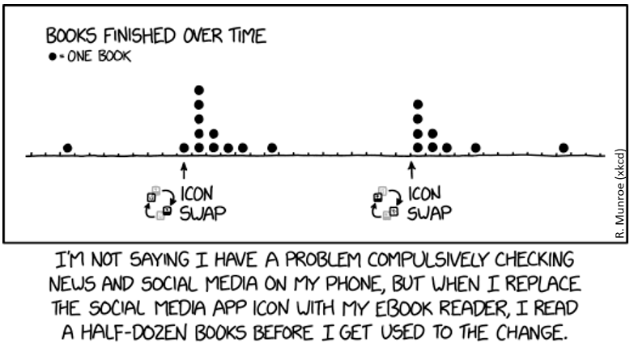

## What is a Dotplot?
<style>.unit p {text-align: justify;}</style>
<div class="unit">

<p><b>Short Version:</b> A Cleveland dotchart compares numeric values for named items. Each item has its own row, and the horizontal position of its dot shows its value. <br> <br>
<b>Long Version:</b> The term “dot plot” is used for several kinds of chart. In a stacked frequency dot plot, dots above the same value or bin count observations. The comic uses stacked dots to count books over time. The R examples below instead use Cleveland dotcharts: each car model has a separate row, and its dot shows miles per gallon on a numeric horizontal axis. The vertical positions identify the models; they do not measure frequencies. A strip plot is another arrangement, which places individual observations along a numeric axis, optionally separated into groups.
</p></div>

Create Cleveland dotcharts with `dotchart(x, labels=)`, where `x` is a numeric vector and `labels` supplies a label for each point. The `groups=` option takes a factor specifying the groups. Use `gcolor=` for the group labels, `color=` for the points and item labels, and `cex=` for their size. See the [R documentation for `dotchart()`](https://stat.ethz.ch/R-manual/R-devel/library/graphics/html/dotchart.html).

## Example with mtcars:
__Not grouped or coloured; original row order:__

```r
data(mtcars) #loading mtcars
dotchart(mtcars$mpg,labels=row.names(mtcars),cex=.7,
         main="Gas Milage for Car Models",
         xlab="Miles Per Gallon")

```




### Dotplot by gears
__Grouped, Sorted and Colored, sort by mpg, group and color by gears:__

```r
x <- mtcars[order(mtcars$mpg),] # sort by mpg
x$gear <- factor(x$gear) # it must be a factor
x$color_gear[x$gear==3] <- "red"
x$color_gear[x$gear==4] <- "blue"
x$color_gear[x$gear==5] <- "darkgreen"
dotchart(x$mpg,labels=row.names(x),cex=.7,groups= x$gear,
         main="Gas Milage for Car Models\ngrouped by gear",
         xlab="Miles Per Gallon", gcolor="black", color=x$color_gear)
```

### Dotplot by cylinder
__Grouped, Sorted and Colored, sort by mpg, group and color by cylinders:__

```r
x <- mtcars[order(mtcars$mpg),] # sort by mpg
x$cyl <- factor(x$cyl) # must be a factor
x$color_cyl[x$cyl==4] <- "red" # setting red for 4 cylinder
x$color_cyl[x$cyl==6] <- "blue" #setting blue for 6 cylinder
x$color_cyl[x$cyl==8] <- "darkgreen" # setting green for 8 cylinder
dotchart(x$mpg,labels=row.names(x),cex=.7,groups= x$cyl,
         main="Gas Milage for Car Models\ngrouped by cylinder",
         xlab="Miles Per Gallon", gcolor="black", color=x$color_cyl)
```



### Difference between Dotplot and Scatterplot:
* The **Cleveland dotchart** below compares one numeric variable, miles per gallon, across named car models. Each row identifies a car model; the dot's horizontal position gives its mpg value. It is not a stacked frequency plot.

* A **scatterplot** shows two numeric variables for each observation. Here, each point represents one car, with horsepower on the horizontal axis and miles per gallon on the vertical axis. The pattern can reveal trends, clusters and unusual observations. The axes do not by themselves establish a causal relationship.


